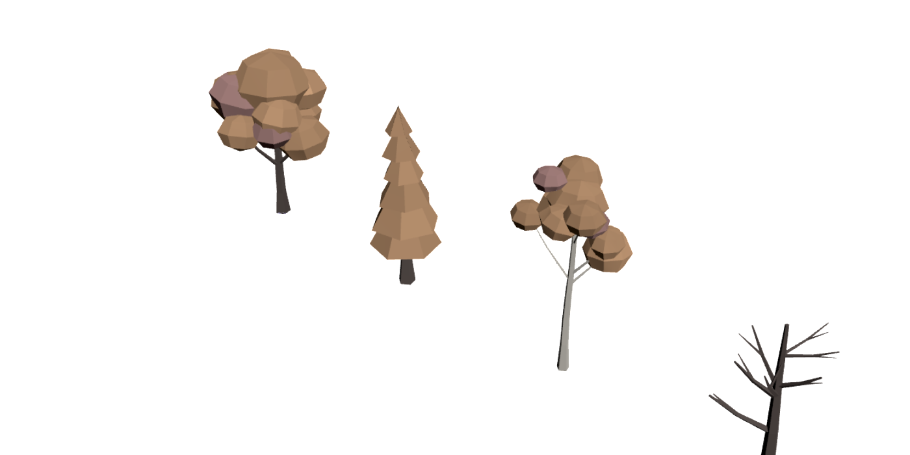
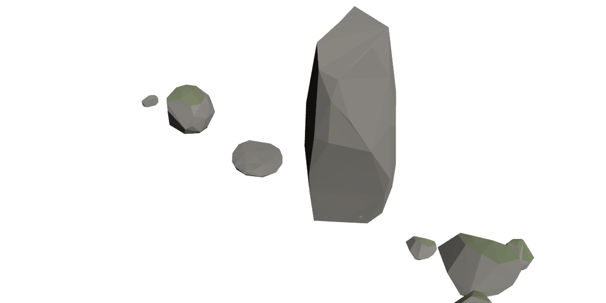

# Low-Poly Nature Kit

**Research Project 1 · Houdini 22 → Houdini Engine → Unreal Engine 5.8**

A family of procedural low-poly asset generators made in Houdini (Houdini Digital Assets), sharing one style system, to fill the worlds of the Interactive World Builder (Unreal). Proposal: https://github.com/elisedumaine/Research-Project-1-proposal

## What is in the kit so far

| HDA | What it does |
|---|---|
| `hda/lpk_style.hda` | The shared style. Every generator ends with it. It paints each face with the palette color of its part (bark, leaf, accent, rock…), varies the color a little per piece and per face, and makes every face flat (hard normals). Controls: Seed, Palette (the 7 World Builder palettes + Natural), Bark Tone, Color Variation. |
| `hda/lpk_rock.hda` | Rock generator: Pebble, Boulder, Slab (flat stepping stone), Cliff, Cluster (one big rock and a few small ones). Controls: Seed, Type, Size, Tallness, Roughness, Chisel Cuts, Cut Depth, Moss, Cluster Rocks, Detail, plus the style controls. |
| `hda/lpk_tree.hda` | Tree generator: Broadleaf, Pine, Birch, Dead. Controls: Seed, Species, Height, Trunk Width, Lean, Branches, Branch Length, Crown Size, Lumpiness, Accent Clumps, Detail, plus the style controls. |





## How a rock is made

1. A ball is stretched into the type's proportions and turned to a random angle; a soft noise gives it big lumps.
2. **Chisel cuts:** a few random flat planes slice it, like a sculptor's chisel. That gives the big flat faces of a low-poly rock. The bottom is cut flat so it sits on the ground.
3. PolyReduce brings it down to a few dozen faces (Detail). Cluster copies it a few times, big and small.
4. Faces that look up can become moss; `lpk_style` paints and flattens.

## How a tree is made

1. A VEX wrangle grows the skeleton: a bent, tapering trunk and branches, built as low-sided tubes, plus foliage points at the branch tips (size, rotation, squash).
2. Faceted balls (broadleaf, birch) or cones (pine) are copied onto those points. Dead trees get none.
3. A noise makes every foliage clump lumpy and unique.
4. `lpk_style` paints everything and makes the facets flat.

## Use it

1. Open Houdini. In the Asset Manager (or *File → Import → Houdini Digital Asset*), install the files in `hda/` (`lpk_style.hda` first).
2. In a Geometry node, press Tab and type **LPK Tree**. Change the sliders.
3. Or open `houdini/lpk_workshop.hipnc`: one tree of each species side by side.

The HDAs are rebuilt from the scripts in `scripts/`, with Houdini open and the local bridge running:

```powershell
python Tools/houdini.py -f scripts/build_style.py
python Tools/houdini.py -f scripts/build_tree.py
python Tools/houdini.py -f scripts/build_rock.py
python Tools/houdini.py -f scripts/demo_trees.py   # demo scene: trees
python Tools/houdini.py -f scripts/demo_rocks.py   # demo scene: rocks
python Tools/houdini.py -f scripts/snapshot.py     # viewport picture in captures/
```

## Plan

- **Nov 10:** style system ✅, trees ✅, rocks ✅ (first versions), both loaded in Unreal through Houdini Engine.
- **Nov 17:** plants, Low-Polify for imported models, baking variations into Unreal, used by the World Builder.
- **Nov 23:** mushrooms, props, level-of-detail slider, demo video, documentation.
